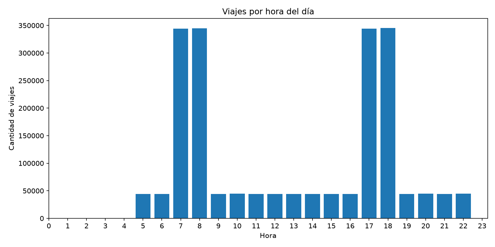
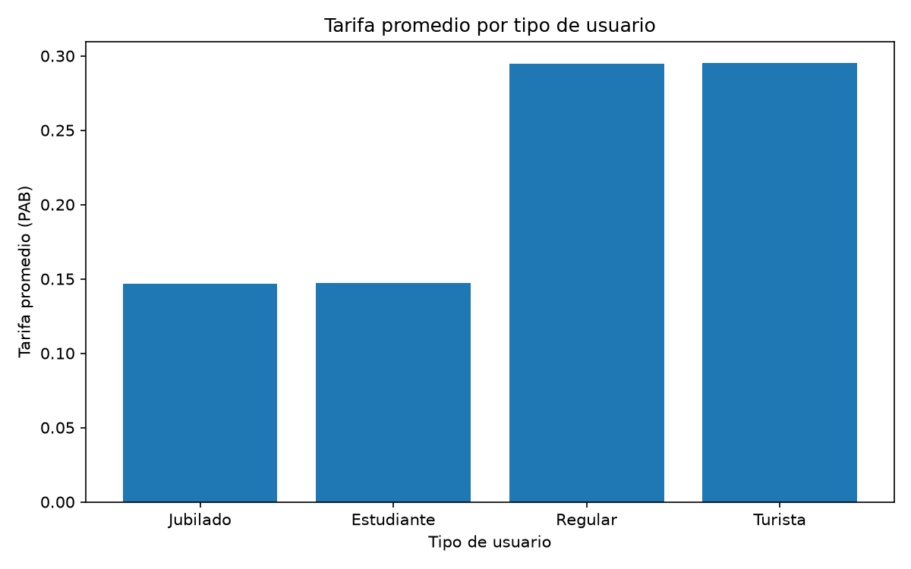

# Análisis exploratorio de datos (EDA) — MoviData Panamá

## 1. Objetivo y fuente

Este análisis explora el dataset de viajes de transporte público (Metro y Metrobús) antes de construir los módulos de análisis. Busca confirmar la calidad de los datos y entender cómo se distribuye la demanda.

- **Fuente:** `data/viajes_movidata.csv`, generado con `generar_dataset_movidata.py` (datos simulados).
- **Tamaño:** 2,000,000 de viajes y 16 columnas.
- **Periodo:** del 1 de junio de 2024 al 30 de noviembre de 2024.
- **Herramienta:** `scripts/eda.py`, con pandas y matplotlib. Es un script de exploración aparte; no forma parte del núcleo de la aplicación, que accede a los datos mediante el patrón Repository.

## 2. Calidad de los datos

| Dato | Valor |
| --- | --- |
| Registros | 2,000,000 |
| Columnas | 16 |
| Valores vacíos | 0 |
| `trip_id` repetidos | 0 |
| Primer viaje | 2024-06-01 05:00:00 |
| Último viaje | 2024-11-30 22:59:00 |

El dataset no tiene valores vacíos ni identificadores repetidos, por lo que la limpieza del `DataLoader` (eliminar duplicados y vacíos) no descartará registros.

## 3. Estadísticos descriptivos

| Variable | Media | Desv. est. | Mín. | 25 % | Mediana | 75 % | Máx. |
| --- | --- | --- | --- | --- | --- | --- | --- |
| `hour` | 12.9 | 5.12 | 5.0 | 8.0 | 14.0 | 18.0 | 22.0 |
| `distance_km` | 7.1 | 4.45 | 0.51 | 3.83 | 6.13 | 9.33 | 45.0 |
| `duration_min` | 23.71 | 15.28 | 2.0 | 12.6 | 20.7 | 31.6 | 120.0 |
| `fare` (PAB) | 0.25 | 0.08 | 0.12 | 0.18 | 0.25 | 0.35 | 0.35 |

Cada variable tiene 2,000,000 de observaciones.

## 4. Distribuciones por categoría

**Modo de transporte**

| Modo | Viajes | % |
| --- | --- | --- |
| Metrobus | 1,100,281 | 55.01 |
| Metro | 899,719 | 44.99 |

**Tipo de usuario**

| Tipo | Viajes | % |
| --- | --- | --- |
| Regular | 1,365,300 | 68.26 |
| Estudiante | 397,243 | 19.86 |
| Jubilado | 177,464 | 8.87 |
| Turista | 59,993 | 3.00 |

**Método de pago**

| Método | Viajes | % |
| --- | --- | --- |
| Tarjeta_Metro | 1,560,377 | 78.02 |
| Tarjeta_bancaria_NFC | 279,557 | 13.98 |
| QR_movil | 160,066 | 8.00 |

**Clima**

| Clima | Viajes | % |
| --- | --- | --- |
| Soleado | 999,539 | 49.98 |
| Nublado | 560,548 | 28.03 |
| Lluvia | 359,788 | 17.99 |
| Tormenta | 80,125 | 4.01 |

**Las 5 rutas con más viajes**

| Ruta | Viajes | % |
| --- | --- | --- |
| Linea 1 | 450,194 | 22.51 |
| Linea 2 | 449,525 | 22.48 |
| C820-Tocumen | 110,426 | 5.52 |
| C800-Albrook | 110,400 | 5.52 |
| M300-Los Andes | 110,222 | 5.51 |

## 5. Gráficos

*Figura 1. Cantidad de viajes por hora del día.*

*Figura 2. Tarifa promedio por tipo de usuario.*

## 6. Hallazgos

1. **La demanda tiene dos picos muy marcados.** Las horas 7, 8, 17 y 18 concentran cerca de 344,000 viajes cada una (la hora 18 es la mayor, con 345,431), el 68.91 % del total. Las demás horas tienen cerca de 44,000 viajes, unas ocho veces menos. Esto corresponde a la entrada y la salida del trabajo y de las clases, y sugiere reforzar las frecuencias en esas franjas. No hay viajes entre las 23:00 y las 4:59.

2. **Estudiantes y jubilados pagan cerca de la mitad de la tarifa.** El promedio es de 0.147 PAB para ambos, frente a 0.295 PAB de los usuarios regulares y turistas (Figura 2), es decir, la mitad. Esto es coherente con los descuentos del sistema y es un dato clave para el análisis de recaudación: los estudiantes y jubilados son el 28.7 % de los viajes, pero aportan menos ingresos por viaje.

3. **El Metro se concentra en dos líneas y el Metrobús se reparte en muchas rutas.** La Línea 1 y la Línea 2 suman exactamente los 899,719 viajes del Metro, con cerca del 22.5 % del total cada una. En cambio, las rutas de Metrobús más usadas tienen apenas 5.5 % cada una, lo que indica una demanda más dispersa. Para el análisis de rutas conviene separar los resultados por modo.

4. **Predominan los usuarios regulares y el pago con Tarjeta Metro.** Los usuarios regulares son el 68.26 % de los viajes y la Tarjeta Metro se usa en el 78.02 %. Los turistas son solo el 3 %, por lo que cualquier conclusión sobre ellos tiene una base pequeña.

5. **Distancia y duración están sesgadas a la derecha.** La media (7.1 km y 23.71 min) es mayor que la mediana (6.13 km y 20.7 min) y hay valores máximos de 45 km y 120 min. Pocos viajes largos elevan el promedio, así que para describir un viaje típico es mejor usar la mediana.

## 7. Limitaciones

- Los datos son **simulados**: los picos casi idénticos en las horas 7, 8, 17 y 18 y la distribución pareja en el resto reflejan los pesos usados al generar el dataset, y no necesariamente el comportamiento real de la ciudad.
- Las conclusiones aplican a los 2,000,000 de viajes del CSV. En MongoDB Atlas solo se cargó un subconjunto de 1,000,000 de documentos por el límite del plan gratuito, por lo que las cifras absolutas allí serán distintas.

## 8. Cómo reproducirlo

Desde la raíz del proyecto, con el entorno virtual activo: `python scripts/eda.py`. Genera las tablas en `docs/eda_tablas.md` y los dos gráficos en `docs/`.